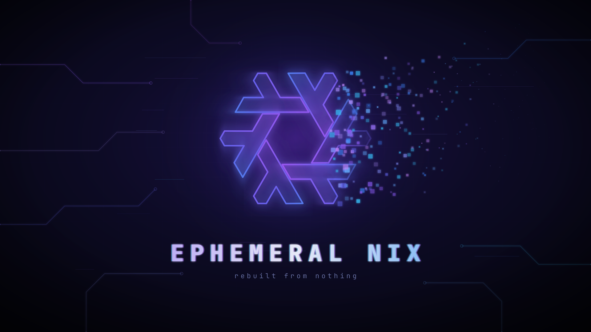
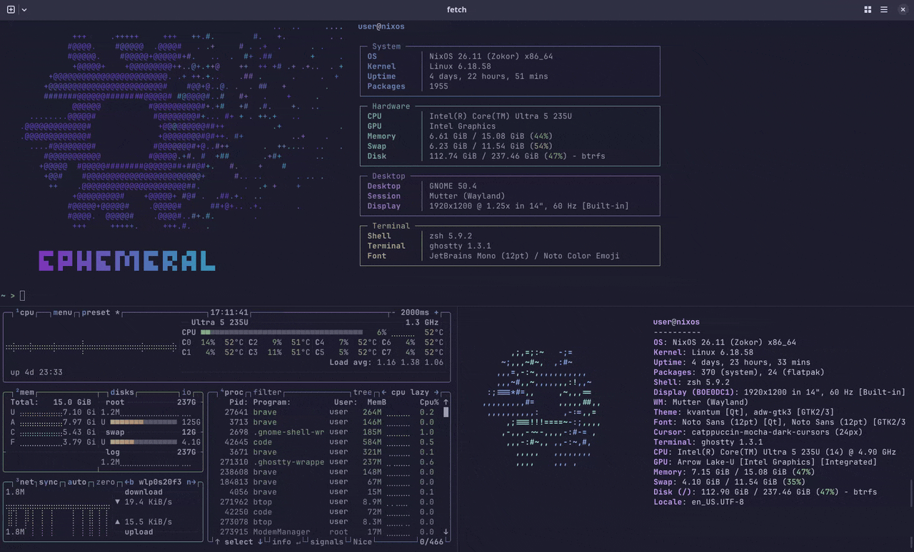

# Ephemeral Nix Config

[](https://github.com/the-wittch/ephemeral-nixos-config/actions/workflows/ci.yml)



The NixOS config for machines installed with [ephemeral-nixos](https://github.com/the-wittch/ephemeral-nixos). `/` is wiped on every boot; `/home` and a short list of system paths live on `/persist`.

> [!NOTE]
> Ephemeral Nix is a solo passion project. I read every issue and get to each one as quickly as I can, but there's one of me, so there's no set response time.

The installer sets up the full system by default. Next to a plain desktop, it adds:

- Home Manager dotfiles: zsh, git, starship, zoxide, neovim and ghostty.
- A dark Catppuccin Mocha theme everywhere, through [Stylix](https://github.com/nix-community/stylix), with the snowflake as the default user picture.
- Hourly snapper snapshots of `/persist`, and desktop warnings when a disk starts failing.
- OpenSnitch, Syncthing, Podman, Flatpak with Flathub, Firefox and scanning.
- Rebuilds through [nh](https://github.com/nix-community/nh), with a summary of what changed.
- Laptop extras (thermald, battery reporting, fingerprint login) when the hardware is there.
- Optional NVIDIA drivers, Tailscale, DNS over TLS through Control D, SMB mounts, and machine settings pulled from Proton Pass.

A fresh install stays lean. `"extras": true` adds the bigger things:

- Steam, VS Code, Brave, VLC, distrobox, Syncthing Tray, 7-Zip, unrar, git-crypt and age.
- atuin, fzf, bat, tealdeer, yazi, btop and fastfetch in the shell; it greets each new Ghostty window with the wallpaper's snowflake.
- `,` to run any program once without installing it, and command-not-found suggestions.



fastfetch on a new Ghostty window, with btop (bottom left) and [fetch](https://github.com/areofyl/fetch) (bottom right, not included).

The installer asks about extras. Anything else you don't want can be switched off in your own modules ([Customizing](docs/customizing.md)).

> **On the full profile, outgoing connections are blocked until you allow them.** OpenSnitch asks the first time each program connects somewhere. If an app can't connect, a missed or denied prompt is the likely cause: open OpenSnitch and check its Rules. `"useOpenSnitch": false` turns it off.

New here? Start with [the first hour](docs/first-hour.md).

## Limits

- x86_64 with UEFI, Secure Boot off.
- The whole disk is wiped at install. No dual boot.
- One user per machine.
- Suspend works; hibernation doesn't.
- The disk unlocks with a passphrase only, no TPM.
- It's opinionated: Catppuccin, Ghostty and zsh by default. Changing them takes a module of your own ([appearance](docs/appearance.md)).

## Setup

The installer asks what you want and installs it: the full system with the options you picked, or a small install with a plain desktop. The machine's config is in `/persist/etc/nixos`: `settings.json`, `hardware-configuration.nix`, and a short `flake.nix` that pins a release of this repo.

### Change what's installed

```bash
ephemeral-setup
```

It switches between the full system and the small install (`"profile": "full"` or `"minimal"`), asks which options you want (extras, OpenSnitch, the Proton Pass SSH agent, Control D), and rebuilds. After a small install, this is how you get the rest. Log out and back in when it's done.

`extras`, `useControlD`, `usePassSshAgent`, `useFlakePassCli` and the apps in `apps.json` only apply to the full system; on the small install the rebuild warns that they're ignored.

> **Just want to get going?** Run `ephemeral-apps` and tick the apps you want. No Nix files to edit: your picks are saved to `apps.json` and installed on the next rebuild, and you can run it again any time to add or remove apps.

### Keep it in git

```bash
cd /persist/etc/nixos
git init
git add -A
git commit -m "my machine"
```

Push it to a private repo. `settings.json` and `hardware-configuration.nix` are gitignored, so they stay on the machine; `ephemeral-update` still sees them, and [`ephemeral-backup`](docs/backup.md) saves them.

## Rebuild and update

```bash
ephemeral-update
```

It rebuilds from `/persist/etc/nixos` and switches to the result, with readable progress and a list of what changed at the end. The same command takes you back when something goes wrong:

| | |
|---|---|
| `ephemeral-update --check` | build a change without switching to it, to see whether it works |
| `ephemeral-update --previous` | go back to the system before the last rebuild |
| `ephemeral-update --list` | the systems you can go back to, with their dates and config releases |
| `ephemeral-update --as-installed` | the system exactly as it was installed; your files stay |

`ephemeral-doctor` checks the machine: that `/` was wiped, what failed, free space, snapshots, whether a newer release is out, and each problem with the command that fixes it.

`flake.nix` pins a release of this repo:

```nix
{
  inputs.ephemeral.url = "github:the-wittch/ephemeral-nixos-config/v4.1.0";
  outputs = inputs: inputs.ephemeral.lib.mkFlake { inherit inputs; root = ./.; };
}
```

`ephemeral-update` checks for a newer release before it rebuilds. If there is one, it links the changelog and asks whether to move to it, then changes the tag and updates the lock for you. After an install, `/persist/etc/nixos` belongs to root; `ephemeral-update` and `ephemeral-setup` both offer to make it yours, so it can be edited and kept in git.

To do it by hand instead, change the tag, then:

```bash
nix flake update ephemeral --flake /persist/etc/nixos
ephemeral-update
```

While the folder still belongs to root, the first command needs `sudo` in front.

Read [`CHANGELOG.md`](CHANGELOG.md) before a new major version; it lists what you have to change. Settings that were removed still load with a warning that says what to do.

A machine gets new packages, security fixes included, only with a new release here. A patch release comes out every Monday with the newest nixpkgs, once it passes the boot tests. The other inputs, such as Home Manager and Stylix, are updated once a month after I've read what changed upstream. This repo tracks `nixos-unstable` and moves to the stable 26.11 channel once that's released. For fixes sooner, give your machine its own nixpkgs, which replaces this repo's:

```nix
inputs.nixpkgs.url = "github:NixOS/nixpkgs/nixos-unstable";
```

and update it with `nix flake update nixpkgs --flake /persist/etc/nixos`. That combination isn't tested here, so try it with `nix run path:.#vm` first.

## Commands

`ephemeral-help` lists these, so there's no need to remember them:

| command | what |
|---------|------|
| `ephemeral-update` | rebuild after a change and get new releases; `--check`, `--previous`, `--list` and `--as-installed` as above |
| `ephemeral-doctor` | check the machine and say how to fix what isn't right; `kept` and `lost` show what survives a reboot |
| `ephemeral-setup` | switch between the full system and the small install, and turn the main options on or off |
| `ephemeral-passwd` | change your login password |
| `ephemeral-backup <folder>` | save the settings and secrets a reinstall needs, encrypted |
| `ephemeral-report` | system details to paste into a bug report |
| `controld-setup` | set or turn off the Control D resolver id |
| `smb-setup` | add or remove SMB shares |
| `ephemeral-apps` | pick extra apps by category, then rebuild |
| `luks-header-backup <file>` | copy the LUKS header to a USB stick |
| `settings-from-pass` | pull settings from Proton Pass |
| `ssh-pubs-from-pass` | write SSH public keys from Proton Pass to `~/.ssh` |
| `update-pass-cli` | bump or check the pinned pass-cli (run in a checkout of this repo) |

Most of them ask what to do; `--help` on one shows its options. The small install has `ephemeral-update`, `ephemeral-doctor`, `ephemeral-setup`, `ephemeral-passwd`, `ephemeral-backup`, `ephemeral-report` and `luks-header-backup`; `ephemeral-help` lists the ones a machine has.

## Documentation

- [The first hour](docs/first-hour.md): what to do right after installing
- [Features](docs/features.md): snapshots, Control D, SMB, NVIDIA, Proton Pass and the rest
- [settings.json](docs/settings.md): every setting
- [Customizing](docs/customizing.md): your own modules, and how this repo is organized
- [Keeping things across reboots](docs/persistence.md)
- [Backups](docs/backup.md): what to copy off the machine, and restoring after a reinstall
- [Dotfiles and appearance](docs/appearance.md): dotfiles, theme, wallpaper
- [Try it in a VM](docs/vm.md)
- [When something breaks](docs/troubleshooting.md): recovery, bug reports, what's tested
- [Security notes](docs/security.md)
- [Working on this repo](docs/development.md)
- [Architecture](ARCHITECTURE.md): how it's built, and the rules every change is checked against
