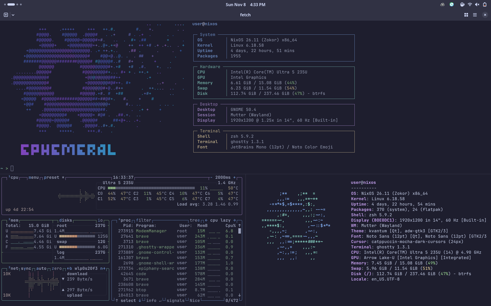

# Dotfiles and appearance

## Dotfiles

Each file in `modules/dotfiles/` sets up one program in Home Manager: zsh with autosuggestions and syntax highlighting, git, starship, zoxide, neovim and ghostty, plus yazi (`y`), btop, fastfetch, atuin, fzf, bat and tealdeer with `extras`. Change them from your own modules, as shown in [Customizing](customizing.md#your-own-modules). When Home Manager has to replace a file that's already there, it renames the old one to `<name>.hm-backup` first. `$EDITOR` is neovim, or VS Code (`code --wait`) with `extras`.



## Theme

Stylix applies the [Catppuccin Mocha](https://catppuccin.com) palette to GTK and Qt apps, GNOME Shell, Noctalia on niri and Umbriel, the boot splash, the console and the dotfiles above. Plasma takes its colors from the wallpaper instead (see [Plasma](#plasma)). Fonts are Noto Sans and Noto Serif, with JetBrains Mono for code. The cursor is Catppuccin Mocha Dark.

To use another [base16 scheme](https://github.com/tinted-theming/schemes):

```nix
{
  flake.modules.nixos.pc =
    { lib, pkgs, ... }:
    {
      stylix.base16Scheme = lib.mkForce "${pkgs.base16-schemes}/share/themes/tokyo-night-dark.yaml";
    };
}
```

Pointing at a scheme file means Nix has to build `base16-schemes` while evaluating, which `nix flake check --no-build` refuses. To keep that check working, copy the scheme's colours inline, the way `modules/stylix.nix` does.

Some Stylix features are switched off:

- Its package overlays rebuild GNOME Shell and a few libraries from source on every update. Without them the GDM login screen isn't themed, but it is still dark.
- The VS Code target replaces `settings.json` with a read-only file. Turn it back on with `stylix.targets.vscode.enable = lib.mkForce true` in `flake.modules.homeManager.base`.
- The browser target sets a Chromium/Brave policy, which locks the theme colour and shows "managed by your organization".
- Setting the wallpaper on every login, so that one you pick yourself sticks.

## Plasma

On the full profile, Plasma is set up with [plasma-manager](https://github.com/nix-community/plasma-manager) in `modules/desktop/plasma-home.nix`:

- [Krohnkite](https://codeberg.org/anametologin/Krohnkite) tiles windows, starting in three columns. `Meta+F` floats or tiles a window, `Meta+\` cycles the layouts, and Steam always floats. Turn it off in System Settings, Window Management, KWin Scripts.
- The colors come from the desktop wallpaper. [matugen](https://github.com/InioX/matugen) makes a dark color scheme from it at login and again whenever you pick a new wallpaper. Fonts and the cursor are the same as everywhere else.

Settings plasma-manager doesn't set stay yours to change in System Settings.

## User picture

The snowflake from the wallpaper is the default user picture on the login screen and in the desktop's user settings. It's only filled in when there's no picture yet, so one you pick yourself stays.

## Wallpaper

`assets/wallpaper.svg` is rendered to a 4K PNG at build time and installed at `/run/current-system/sw/share/backgrounds/ephemeral/wallpaper.png`. It's the default on GNOME (desktop, lock screen and login screen), on niri and Umbriel, and on the Plasma login screen. On the Plasma desktop, pick that file in the wallpaper settings. GNOME's own wallpapers are still there to choose from.

The snowflake is the "NixOS Logo" by [Simon Frankau](https://github.com/simon-frankau), [Tim Cuthbertson](https://github.com/timbertson) and [Daniel Baker](https://github.com/djacu) (maintained by the [NixOS Marketing Team](https://nixos.org/community/teams/marketing/)), from [NixOS/branding](https://github.com/NixOS/branding), licensed under [CC BY 4.0](https://creativecommons.org/licenses/by/4.0/). It has been recoloured.
